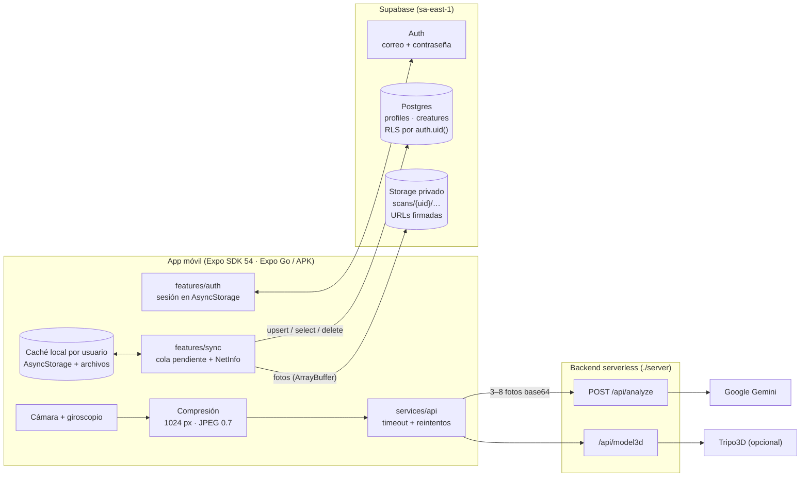

# Cazador de Objetos

Escanea un objeto real en 360°, deja que la IA lo identifique y conviértelo en una **criatura coleccionable** que se guarda en tu cuenta.

Proyecto universitario: Diseño de Interfaces e Ingeniería de Software. Entrega: 8 de noviembre de 2026.

## Instalar y probar

| Teléfono | Cómo | QR |
|---|---|---|
| **iPhone** | Instala **Expo Go** desde el App Store. Escanea el QR con la app **Cámara** y toca "Abrir en Expo Go". No hace falta computador. |  |
| **Android** | Descarga e instala el **APK** (permite "instalar apps desconocidas" cuando el teléfono lo pida). |  |

- Enlace de Expo Go (canal `preview`): `exp://u.expo.dev/814da54f-35b2-4fd9-be5f-40e290e7b679?channel-name=preview`
- APK (build `2c4fbdf2`, versión 1.0.0, canal `preview`): https://expo.dev/artifacts/eas/0CYn4vdkn08rP9dAhxcUob4zycHfNk_oD6ghTacphIc.apk
- Panel del update: https://expo.dev/accounts/jairotr1/projects/cazador-de-objetos/updates/61f70e64-f18f-4bda-a059-a867ddde0edc

> **Por qué SDK 54:** Expo Go del App Store se quedó en SDK 54 (las versiones 55+ no están en la tienda), así que el proyecto usa SDK 54 para que el iPhone funcione sin compilar nada. En Android se usa el APK, que no depende de Expo Go. El APK y Expo Go reciben el **mismo update** porque comparten el runtime `exposdk:54.0.0` y el canal `preview`.

---

## Qué hace

1. **Onboarding** de 3 pasos. Explica el permiso de cámara antes de pedirlo.
2. **Bienvenida**: "Crear cuenta", "Iniciar sesión" o "Probar sin cuenta". La sesión queda guardada y la próxima vez entra directo.
3. **Inicio** con el botón protagonista "Escanear objeto", la última captura, el progreso de colección y la racha de días.
4. **Escáner 360°.** El giroscopio (yaw de `DeviceMotion`) llena un anillo de 8 segmentos mientras rodeas el objeto, y en cada segmento nuevo la app toma una foto con haptic y destello. También hay captura manual. "Listo" se activa desde 3 fotos.
5. **Procesando.** La IA analiza las fotos (Gemini) y, si hay llave de Tripo3D, se reconstruye el 3D en paralelo.
6. **Revelación.** Destello del color de la rareza con haptics, tarjeta de la criatura y visor 3D o 360° de fotos.
7. **Guardar.** Se guarda primero en el teléfono (al instante) y luego se suben fotos y ficha a Supabase. Sin conexión queda **pendiente** y se sincroniza sola al volver la red.
8. **Colección** desde la nube con caché local: filtros, búsqueda, orden, pull-to-refresh, skeleton y error con "Reintentar".
9. **Perfil** con usuario, total, conteo por rareza y "la más rara" (desde la base de datos), logros, ajustes y "Cerrar sesión".
10. **Modo invitado y modo demo.** Sin cuenta, todo vive en el teléfono; al crear cuenta se ofrece "Subir mi colección". Sin backend, la app usa criaturas de ejemplo etiquetadas **DEMO**.

## Arquitectura



**Seguridad:** la app solo conoce la URL y la anon key de Supabase, que son públicas por diseño. Cada tabla tiene RLS (`user_id = auth.uid()`) y el bucket `scans` es privado, con políticas por carpeta `{auth.uid()}/…`. Las llaves de Gemini y Tripo viven solo en Vercel. La contraseña de la base de datos está solo en `.env.local` (ignorado por git).

### Estructura

```
app/                       Rutas (Expo Router)
  (tabs)/                  Inicio · Colección · Perfil (+ botón central Escanear)
  welcome  sign-in  sign-up  forgot-password  import-collection
  onboarding  scan  processing  result  creature/[id]
src/
  components/              AppText, Button, TextField, FormScreen, Chip, Icon, Skeleton, EmptyState, TabBar
  features/
    auth/                  authStore (sesión, invitado), validación de formularios
    sync/                  cola de sincronización, refresco desde la nube, migración del invitado
    collection/            store de colección con caché por usuario
    scanner/ creatures/ profile/
  services/
    supabase/              cliente, errores en español, acceso a creatures/profiles/storage
    api/                   backend (analyze, model3d con Strategy)
    storage/  motion/
supabase/migrations/       Esquema, RLS, trigger de perfiles y bucket "scans"
scripts/test-supabase.mjs  Prueba de integración (RLS, Storage, re-login, /api/analyze)
server/                    Proyecto Vercel independiente
docs/evaluacion-heuristica.md
```

**Patrones usados**

- **Strategy/Adapter** en `Model3DProvider` (Tripo → visor 360° de respaldo).
- **Store externo + `useSyncExternalStore`** para sesión, colección y escaneo.
- **Guardado optimista + cola** (`syncStatus: local | pending | synced`): la UI nunca espera a la red. La subida es idempotente porque el id local es un UUID que coincide con el de la base de datos.
- **Backend como proxy** para las llaves de IA.

## Modelo de datos (Supabase)

| Tabla | Columnas principales | RLS |
|---|---|---|
| `profiles` | `id` (= `auth.users.id`), `username` (único), `created_at` | leer y actualizar solo el propio. Lo crea un trigger al registrarse con el `username` de la metadata |
| `creatures` | `id`, `user_id` (default `auth.uid()`), `name`, `object_label`, `rarity`, `type`, `description`, `stats` jsonb, `photo_urls` text[] (rutas en `scans`), `glb_url`, `analysis` jsonb (ficha completa), `is_demo`, `created_at` | select/insert/update/delete solo donde `user_id = auth.uid()` |
| `storage.objects` (bucket `scans`, privado) | `{uid}/{creature_id}/{n}.jpg` | leer/escribir/borrar solo en la carpeta propia |

`username_available(text)` es una función `security definer` que responde solo true/false, para validar el usuario antes de registrarse sin exponer perfiles ajenos.

## Desarrollo

Requisitos: Node 20+, Expo Go (SDK 54) en el teléfono.

```bash
npm install
cp .env.example .env     # EXPO_PUBLIC_API_URL, EXPO_PUBLIC_SUPABASE_URL, EXPO_PUBLIC_SUPABASE_ANON_KEY
npx expo start --tunnel
```

| Dónde | Variable | Uso |
|---|---|---|
| `.env` y `eas.json` | `EXPO_PUBLIC_API_URL` | URL del backend en Vercel |
| `.env` y `eas.json` | `EXPO_PUBLIC_SUPABASE_URL` / `EXPO_PUBLIC_SUPABASE_ANON_KEY` | Proyecto Supabase (públicas; la seguridad es RLS) |
| `.env.local` (no se sube) | `SUPABASE_DB_PASSWORD` | Contraseña de Postgres para `supabase db push` |
| Vercel | `GEMINI_API_KEY`, `TRIPO_API_KEY` (opcional) | Llaves de IA, solo en el servidor |

### Supabase

```bash
npx supabase link --project-ref wgsbocrzmbplzppkjcxj
npx supabase db push --remote          # aplica supabase/migrations
npx supabase config push               # auth: sin confirmación de correo, contraseña ≥ 8
node scripts/test-supabase.mjs         # prueba de integración completa
node scripts/create-demo-account.mjs   # cuenta demo (credenciales en ENTREGA.local.md)
```

### Publicar

```bash
npx eas-cli@latest update --branch preview --message "…"      # Expo Go + APK
npx eas-cli@latest build -p android --profile preview          # APK nuevo (solo si cambia código nativo)
```

### Verificación

```bash
npx tsc --noEmit && npx expo lint && npx expo-doctor && npx expo export -p android
```

## Decisiones de diseño

- **Paleta.** Fondo `#0A0A0C`, superficies `#141418` / `#1C1C22`, un único acento de acción **lima `#C6FF3D`** y azul `#2F6BFF` como secundario. Rarezas: Común `#9AA0A6`, Rara `#2F6BFF`, Épica `#FFB020`, Legendaria `#FF5A1F → #E5383B`. Sin morados.
- **Tipografía.** *Bricolage Grotesque* en títulos, *Inter* en texto y *JetBrains Mono* en HUD, números y etiquetas.
- **Sistema.** Espaciado ×8, radios 12/20/28, botones y campos de 52 pt, áreas táctiles ≥ 44 pt, safe areas.
- **Formularios.** Etiqueta siempre visible, validación al salir del campo, error en línea con ícono, mostrar/ocultar contraseña, botón con indicador y deshabilitado mientras carga, haptic de éxito o error.
- **Movimiento.** Un efecto protagonista por pantalla; solo `transform`/`opacity` con Reanimated; respeta "Reducir movimiento".
- **Heurísticas de Nielsen.** Evaluadas en [docs/evaluacion-heuristica.md](docs/evaluacion-heuristica.md), incluido el flujo de cuentas y sincronización.

## Limitaciones honestas

- **El 3D no es LiDAR.** Con `TRIPO_API_KEY` se genera con IA a partir de una foto; sin ella (estado actual) se usa el visor 360° de fotos.
- **El giroscopio mide el giro del teléfono, no la posición.** Por eso hay guías y captura manual.
- **Recuperar contraseña** envía el correo de Supabase. El enlace abre la página de Supabase en el navegador; no hay pantalla propia para la nueva contraseña.
- **URLs firmadas de 7 días.** Sin conexión durante más tiempo, solo se ven las fotos ya cacheadas en el teléfono. Las fotos tomadas en ese teléfono siempre se ven.
- **Rate limit del backend** en memoria por instancia; en producción haría falta Redis/KV y autenticar la app ante el backend (por ejemplo, con el JWT de Supabase).
- **El aviso de poca luz** solo es fiable en iOS (EXIF `BrightnessValue`).
