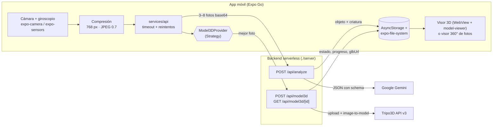

# Cazador de Objetos

Escanea un objeto real en 360°, deja que la IA lo identifique, genera su modelo 3D y conviértelo en una **criatura coleccionable**.

Proyecto universitario: Diseño de Interfaces e Ingeniería de Software. Entrega: 8 de noviembre de 2026.
Funciona en **iPhone y Android con Expo Go**, sin compilar código nativo.

---

## Qué hace

1. **Onboarding** de 3 pasos. Explica el permiso de cámara antes de pedirlo.
2. **Inicio** con el botón protagonista "Escanear objeto", la última captura, el progreso de colección y la racha de días.
3. **Escáner 360°.** El giroscopio (yaw de `DeviceMotion`) llena un anillo de 8 segmentos mientras rodeas el objeto, y en cada segmento nuevo la app toma una foto con haptic y destello. Si el giroscopio no ayuda, puedes tomar las fotos a mano. "Listo" se activa desde 3 fotos.
4. **Procesando.** La IA analiza las fotos (Gemini) y en paralelo se reconstruye el 3D (Tripo3D). Una nube de puntos se arma con el progreso real. Si el 3D tarda, ves la criatura y el modelo termina de cargar en segundo plano.
5. **Revelación.** Un destello del color de la rareza con haptics, la tarjeta de la criatura y un visor 3D del objeto (rotar, pinch zoom, auto-rotación). Sin 3D, se muestra un visor 360° con tus fotos y una nube de puntos.
6. **Colección** offline con filtros (rareza, tipo), búsqueda y orden. El detalle muestra el visor 3D o 360°, permite exportar el `.glb` y eliminar la criatura.
7. **Perfil** con estadísticas, logros y ajustes (reducir animaciones, haptics, borrar datos, criaturas demo).
8. **Modo demo.** Sin conexión o sin backend, la app usa 3 criaturas de ejemplo y un `.glb` incluido en `assets/`, etiquetados como **DEMO**.

## Arquitectura



### Estructura

```
app/                      Rutas (Expo Router)
  (tabs)/                 Inicio · Colección · Perfil (+ botón central Escanear)
  onboarding.tsx  scan.tsx  processing.tsx  result.tsx  creature/[id].tsx
src/
  components/             UI base: AppText, Button, Chip, Icon, Skeleton, EmptyState, TabBar
  features/
    scanner/              useScanner (hook), HUD (anillo, retícula, línea, puntos), sesión de escaneo
    creatures/            Tarjeta, badges, stats, visor 3D/360°, nube de puntos, demo, compartir
    collection/           Store de colección (useCollection), racha
    profile/              Ajustes, onboarding, logros
  services/
    api/                  Cliente HTTP, analyze, model3d/ (TripoProvider, FallbackProvider, ChainProvider)
    storage/              AsyncStorage (kv), archivos (fotos y .glb), store reactivo mínimo
    motion/               Yaw "desenrollado" del giroscopio
  theme/                  Tokens de diseño
  types/                  Tipos de dominio
server/                   Proyecto Vercel independiente (funciones TypeScript)
docs/evaluacion-heuristica.md
```

**Patrones usados**

- **Strategy/Adapter** en `Model3DProvider`. `TripoProvider` adapta el backend, `FallbackProvider` usa la vista 360° de fotos y `ChainProvider` cae del primero al segundo. Para cambiar de proveedor 3D basta con escribir otra clase.
- **Store externo + `useSyncExternalStore`** para la colección, los ajustes y la sesión de escaneo, sin dependencias extra. Así el 3D puede terminar en segundo plano y actualizar una criatura ya guardada.
- **Backend como proxy.** Las llaves solo existen en Vercel, y la app solo conoce `EXPO_PUBLIC_API_URL`.

## Cómo correrlo

Requisitos: Node 20 o superior, la app **Expo Go** en el teléfono (App Store o Play Store) y una cuenta de Vercel para el backend.

```bash
npm install
cp .env.example .env            # y pon la URL de tu backend en EXPO_PUBLIC_API_URL
npx expo start --tunnel
```

### Probar en Expo Go

- **iPhone:** abre la app **Cámara**, escanea el QR que muestra la terminal y toca "Abrir en Expo Go".
- **Android:** abre **Expo Go**, toca "Scan QR code" y escanea el QR.
- `--tunnel` funciona aunque el teléfono y la computadora estén en redes distintas. Si están en la misma Wi-Fi, `npx expo start` es más rápido.
- Acepta los permisos de cámara y movimiento. Rodea el objeto despacio con el teléfono apuntándolo.

## Variables de entorno

| Dónde | Variable | Uso |
|---|---|---|
| `.env` (raíz, app) | `EXPO_PUBLIC_API_URL` | URL pública del backend (sin `/` final). No es secreta. |
| `server/.env.local` y Vercel | `GEMINI_API_KEY` | Obligatoria para `/api/analyze`. Se obtiene en Google AI Studio. |
| `server/.env.local` y Vercel | `TRIPO_API_KEY` | Opcional. Sin ella, `/api/model3d` responde `{ fallback: true }`. |
| Vercel (opcional) | `GEMINI_MODEL` | Modelo Gemini (por defecto `gemini-3.6-flash`). |
| Vercel (opcional) | `TRIPO_MODEL` | Modelo de Tripo (por defecto `P1-20260311`). |

Las llaves **nunca** van en la app ni en git. `.gitignore` excluye `.env*`, excepto los `.env.example`.

## Despliegue del backend (Vercel)

```bash
cd server
npm install
npx vercel --prod                          # la primera vez enlaza o crea el proyecto
npx vercel env add GEMINI_API_KEY production
npx vercel env add TRIPO_API_KEY production
npx vercel --prod                          # redeploy para aplicar las variables
```

Endpoints:

| Método | Ruta | Entrada | Salida |
|---|---|---|---|
| POST | `/api/analyze` | `{ images: string[] }` (3–8 JPEG/PNG base64) | `{ objeto, categoria, material, colores[], tamanoEstimado, confianza, criatura{…} }` · 422 si no hay objeto claro |
| POST | `/api/model3d` | `{ image: string }` | `{ taskId }` o `{ fallback: true }` |
| GET | `/api/model3d/:id` | — | `{ estado: en_cola\|procesando\|listo\|fallido, progreso, glbUrl }` |
| GET | `/api/health` | — | Qué servicios están configurados (sin revelar llaves) |

Protecciones: rate limit por IP (en memoria, por instancia), validación de tamaño y tipo de imagen (≤ 4 MB en total), timeouts hacia Gemini (45 s) y Tripo (15–20 s), CORS y errores en español.

Prueba rápida:

```bash
curl https://TU-BACKEND.vercel.app/api/health
```

## Decisiones de diseño

- **Paleta.** Fondo `#0A0A0C` con superficies `#141418` / `#1C1C22` y bordes de 8 % de blanco. El único acento de acción es el **lima `#C6FF3D`** (escáner y CTA), con azul eléctrico `#2F6BFF` como secundario. Rarezas: Común `#9AA0A6`, Rara `#2F6BFF`, Épica `#FFB020` y Legendaria con degradado `#FF5A1F → #E5383B`. No hay morados, para alejarse del look genérico de "app de IA".
- **Tipografía.** *Bricolage Grotesque* (600–800) en títulos con carácter, *Inter* en texto legible y *JetBrains Mono* en el HUD del escáner, los números y las etiquetas en mayúsculas con tracking, que dan un tono técnico de instrumento.
- **Sistema.** Espaciado en múltiplos de 8, radios de 12/20/28, botones de 52 pt, áreas táctiles de 44 pt o más, safe areas y tab bar flotante con indicador animado por spring.
- **Movimiento.** Un efecto protagonista por pantalla (anillos en Inicio, HUD en el escáner, nube de puntos al procesar, destello de rareza al revelar). Solo se animan `transform` y `opacity` con Reanimated, para mantener 60 fps. Se respeta "Reducir movimiento".
- **Heurísticas de Nielsen.** Evaluadas en [docs/evaluacion-heuristica.md](docs/evaluacion-heuristica.md). Destacan el estado visible en cada paso (H1), la prevención de errores con mínimos y confirmaciones (H5) y los errores humanos con acción, incluido el modo demo (H9).

## Limitaciones honestas

- **El 3D no es un escaneo LiDAR.** Lo genera una IA (Tripo3D) a partir de **una** foto, la de más detalle. La forma y la textura son una *interpretación*: las partes que no se ven se inventan. Las fotos de los 8 ángulos sirven para el análisis de Gemini y para el visor 360°.
- **La reconstrucción tarda** entre 30 s y 2 min y consume créditos de Tripo. Sin `TRIPO_API_KEY`, la app usa el visor 360° de fotos.
- **El giroscopio mide el giro del teléfono, no la posición.** Si el usuario gira sobre sí mismo sin rodear el objeto, el anillo también se llena. Por eso existen las guías y la captura manual.
- **El visor 3D** usa `<model-viewer>` en un WebView (no R3F nativo) por su estabilidad en Expo Go. Su script se descarga del CDN la primera vez, así que sin red se usa el visor 360°. `three`, `@react-three/fiber`, `@react-three/drei` y `expo-gl` quedan instalados para migrar a un visor nativo en una *development build*.
- **El rate limit vive en memoria** por instancia serverless. Para producción haría falta un store compartido (Redis o KV) y autenticación de la app.
- **Modelo de IA.** `gemini-2.5-flash` está deprecado según la documentación oficial actual de Google, así que el backend usa `gemini-3.6-flash` (estable) y cae a `gemini-2.5-flash` y `gemini-2.5-flash-lite` si el primero no está disponible. Se puede cambiar con `GEMINI_MODEL`.
- **El aviso de poca luz** solo funciona de forma fiable en iOS, porque depende del EXIF `BrightnessValue`.

## Scripts útiles

```bash
npx tsc --noEmit                    # typecheck de la app
(cd server && npx tsc --noEmit)     # typecheck del backend
npx expo-doctor                     # salud del proyecto Expo
node scripts/generate-assets.mjs    # regenera ícono, splash y el .glb de demo
```
