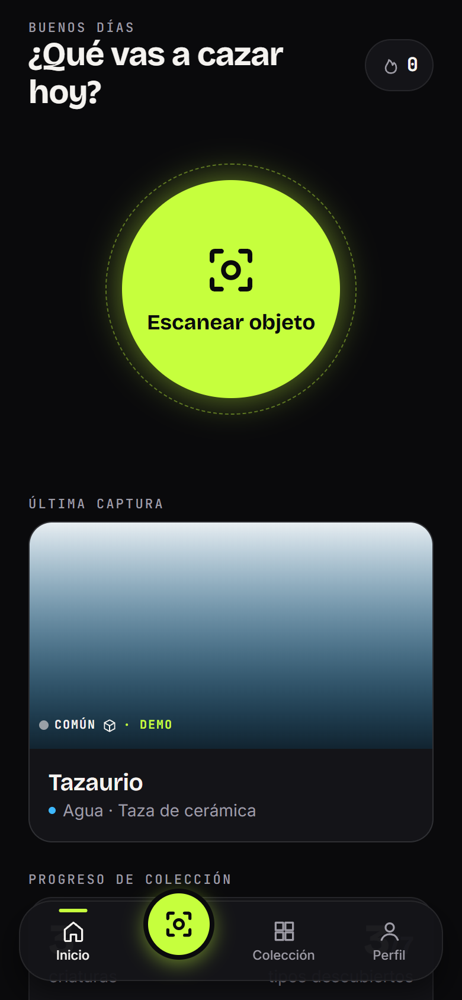
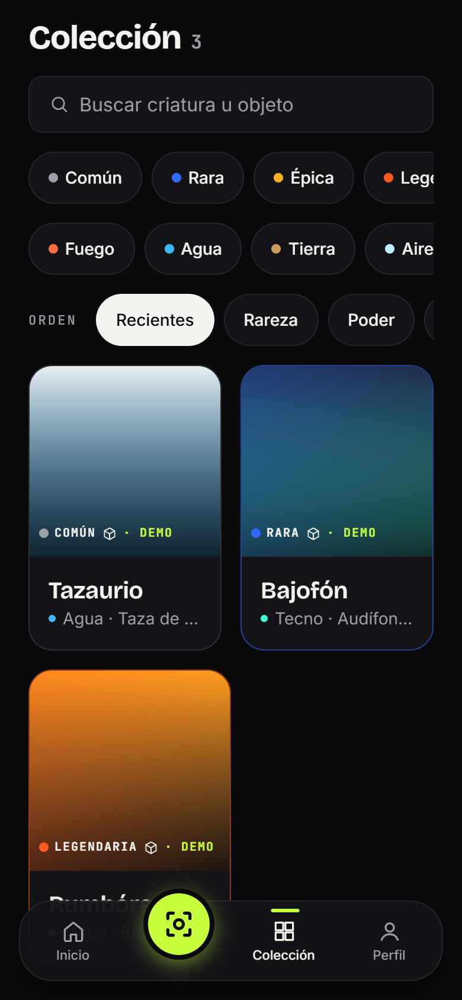
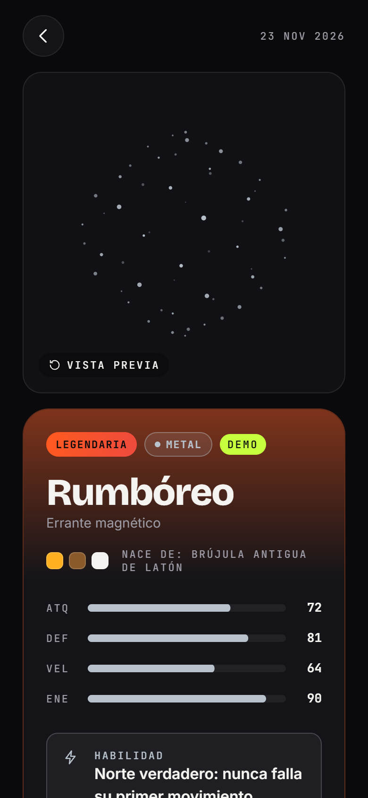

# Cazador de Objetos

**App móvil que convierte objetos reales en criaturas coleccionables.** Escaneas un objeto en 360° con la cámara y el giroscopio, una IA lo identifica y lo transforma en una criatura con rareza, tipo, stats e historia, que se guarda en tu colección.

Proyecto universitario de Diseño de Interfaces e Ingeniería de Software · versión 1.0.1 · noviembre de 2026.

## Problema

Coleccionar es divertido, pero las apps de colección suelen depender de contenido que otro diseñó. Quería que la colección saliera del mundo del usuario: lo que tiene en su escritorio, su cocina o su mochila. Para eso la app tenía que resolver tres cosas difíciles en un teléfono: capturar un objeto desde varios ángulos sin hardware especial, darle a cada objeto un resultado justo y memorable, y no perder nada cuando la señal falla.

## Solución

1. **Escáner 360° guiado.** El giroscopio llena un anillo de 8 segmentos mientras rodeas el objeto y toma una foto en cada ángulo nuevo, con vibración y destello. Con 3 fotos ya se puede analizar.
2. **IA en el servidor.** Las fotos (1024 px, JPEG 0.7) van a un backend en Vercel que consulta a Google Gemini con una respuesta estructurada (JSON Schema). Si la foto no muestra un objeto claro, la app explica cómo mejorar la toma.
3. **Revelación por rareza.** Común, Rara, Épica o Legendaria según lo inusual del objeto; el destello y la vibración crecen con la rareza.
4. **Colección que funciona sin internet.** Se guarda primero en el teléfono y luego se sincroniza con Supabase. Sin señal, los cambios quedan en cola y se suben solos al volver.

## Usuarios

Estudiantes y jóvenes que usan el teléfono en ratos cortos y con datos limitados. Por eso: sin registro obligatorio (modo invitado), fotos comprimidas antes de enviarse y una app que no se bloquea si se pierde la conexión.

## Stack

| Capa | Tecnología |
|---|---|
| App | Expo SDK 54 (54.0.38), React Native 0.81.5, React 19.1, Expo Router 6, TypeScript 5.9, Reanimated 4, React Compiler |
| Sensores | `expo-camera`, `expo-sensors` (DeviceMotion), `expo-haptics` |
| Datos | Supabase: Auth, Postgres con RLS y Storage privado (`@supabase/supabase-js` 2.119) |
| Backend | Funciones serverless en Vercel → Google Gemini (análisis) y Tripo3D (3D opcional) |
| Pruebas | jest-expo 54.0.18, Testing Library 14.1.0, Playwright (verificación visual) |
| Entrega | EAS Update (canal `preview`) para Expo Go y un APK de Android |

## Decisiones de diseño y su porqué

- **Un solo acento lima (#C6FF3D) sobre fondo casi negro.** El botón de escaneo tiene que ser lo primero que ves; con un único color de acción no hay duda de qué tocar. El tema oscuro también ayuda al escanear: la pantalla no deslumbra junto a la cámara.
- **Colores de rareza con contraste medido.** Al auditar, el texto blanco de la insignia "Épica" daba 1,58:1. Cambié el texto de todas las insignias a oscuro (≥ 5:1) y separé "color de relleno" de "color de texto" en los tokens; una prueba automática impide volver a romperlo.
- **Tres tipografías con un trabajo cada una.** Bricolage Grotesque para títulos con carácter, Inter para leer y JetBrains Mono para números, stats y etiquetas del HUD.
- **Espaciado en múltiplos de 8 y áreas táctiles de 44 pt.** La verificación visual encontró chips de 36 pt y enlaces de 17 pt; ahora todos miden lo que el estándar pide.
- **Guardado optimista con cola.** La interfaz nunca espera a la red. Cada criatura usa un UUID generado en el teléfono que es también su id en la base de datos, así que reintentar una subida no crea duplicados.
- **Modo invitado y modo demo.** Probar la app no exige crear cuenta, y una demo en clase no depende de que haya internet.
- **Un solo efecto protagonista por pantalla** (pulso en Inicio, destello en Resultado), y todo respeta "Reducir movimiento" del sistema.
- **La llave de la IA nunca está en el teléfono.** El backend hace de intermediario, valida la entrada y limita las peticiones.

## Retos y cómo se resolvieron

| Reto | Solución |
|---|---|
| Medir "cuánto rodeaste el objeto" sin LiDAR | Ángulo de giro (yaw) de `DeviceMotion` dividido en 8 segmentos, con captura manual como respaldo |
| Límite de 4,5 MB por petición en Vercel | Fotos a 1024 px y JPEG 0.7; si aun así pesan demasiado, se envía un subconjunto de ángulos espaciados (mínimo 3) |
| Expo Go del App Store se quedó en SDK 54 | Se bajó el proyecto de SDK 58 a 54 para que el iPhone funcione sin compilar; Android usa un APK con el mismo canal de updates |
| Sesión vencida sin internet dejaba al usuario fuera | Si Supabase no puede refrescar el token por falta de red, la app entra con la sesión guardada y muestra la colección en caché |
| Datos de un usuario visibles para otro en el mismo teléfono | Caché separada por id de usuario y borrado de la copia local al cerrar sesión; en el servidor, RLS por `auth.uid()` |
| Probar sin teléfono | Jest con mocks de todo el hardware, y capturas automatizadas del build web a dos tamaños de pantalla |

## Resultados medibles

- **154 pruebas automáticas en 13 suites**, en verde en 3 corridas seguidas, sin depender del azar ni del reloj.
- Cobertura por líneas de la lógica crítica: validación 100 %, errores 100 %, cliente HTTP 100 %, colección 87,9 %, sesión 86,8 %, sincronización 78,4 %.
- **34 capturas** (17 pantallas a 390×844 y 360×640) con auditoría automática: 0 elementos cortados.
- `tsc`, `expo lint` y `expo-doctor` (18/18) sin errores.
- 8 defectos de accesibilidad y diseño corregidos en la revisión final (contraste, áreas táctiles, texto grande, movimiento reducido).

## Qué se verificó

Lógica de validación, sesión, cola de sincronización, caché por usuario y cliente HTTP (pruebas automáticas); pantallas sin cámara en dos tamaños (capturas); validación de entrada del endpoint `/api/analyze` en producción; historial de git sin llaves de IA. Detalle en [QA.md](QA.md).

## Limitaciones honestas

- El "3D" no es un escaneo de profundidad: sin la llave de Tripo3D se muestra una vista 360° con las fotos.
- El giroscopio mide el giro del teléfono, no su posición; por eso hay guías y captura manual.
- Cámara, giroscopio, vibración, teclado, modo avión y lectores de pantalla no se pueden automatizar sin un teléfono; quedan en una lista de pruebas manuales.
- El límite de peticiones del backend vive en la memoria de cada instancia; en producción haría falta un almacén compartido.
- Recuperar la contraseña abre la página de Supabase; no hay pantalla propia para la nueva contraseña.
- Las fotos guardadas en la nube usan enlaces firmados de 7 días; más tiempo sin conexión solo deja ver las fotos tomadas en ese teléfono.

## Enlaces

- Repositorio: https://github.com/JAIR0TR1/cazador-de-objetos
- Expo Go (iPhone, canal `preview`): `exp://u.expo.dev/814da54f-35b2-4fd9-be5f-40e290e7b679?channel-name=preview` · QR en [qr-expo-go.png](qr-expo-go.png)
- APK de Android: https://expo.dev/artifacts/eas/0CYn4vdkn08rP9dAhxcUob4zycHfNk_oD6ghTacphIc.apk · QR en [qr-apk.png](qr-apk.png)
